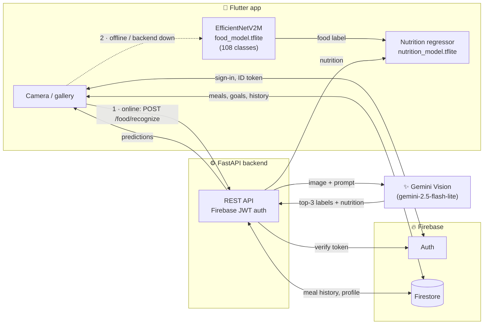

# NutriScan — AI Food Recognition & Nutrition Estimation

> Graduation project · Flutter mobile app · FastAPI backend · TensorFlow / TFLite · Gemini Vision · Firebase

Logging meals by hand is slow, and most food-recognition apps barely cover Egyptian and Middle-Eastern dishes. **NutriScan** lets a user photograph a meal and get the dish name plus calories, protein, carbs, fat and fiber in seconds. Online, the FastAPI backend sends the image to **Gemini Vision**. If the backend is unreachable, the app falls back to an **on-device EfficientNetV2M classifier** (TFLite) trained on 108 international, Arabic and Egyptian food classes. A second small on-device model then estimates nutrition from the food name. Meals, goals and history are stored in **Firebase** (Auth + Firestore).

---

## Key results

### Food classifier (EfficientNetV2M, 108 classes)

| Metric | Value |
|---|---|
| Dataset | **85,310 images** (68,248 train / 17,062 validation), **108 classes** |
| Top-1 accuracy (validation) | **81.41 %** |
| Top-5 accuracy (validation) | **94.14 %** |
| Baseline: MobileNetV2 | 74.25 % top-1 on 81 classes ¹ |
| Parameters | 55.2 M |
| On-device model size (TFLite) | **55.5 MB** |

Dataset composition: Food-101 (80 classes kept, 80,000 images), Arabic Food 101 (3,333 images), a custom Egyptian food set (504 images), and Fruit-101 (1,473 images). Full details are in [`model-training/`](model-training/).

### Nutrition regressor (TF-IDF char n-grams → MLP, 5 outputs)

| Metric | Initial run | Final run |
|---|---|---|
| Mean R² over the 5 nutrients | 0.620 | **0.808** |
| Overall MAE | 20.74 | **13.37** |
| Calories MAPE | 46.5 % | **30.8 %** |
| Calories R² | 0.415 | 0.670 |
| Protein / Carbs / Fat / Fiber R² | 0.730 / 0.796 / 0.758 / 0.400 | 0.850 / 0.868 / 0.850 / 0.804 |
| TFLite size | 6.5 MB | 6.5 MB |

Source: [`model-training/results/`](model-training/results/) ².

### Backend

**15 REST endpoints** (FastAPI). 12 of them require a **Firebase ID token (JWT)**, which the backend verifies with the Firebase Admin SDK. See the [API table](#api-endpoints).

<sub>¹ From the project report. The MobileNetV2 training code is not included in this repo.<br>
² The **final** nutrition numbers come from the saved `evaluation_report.json` of the final Kaggle run. The notebook in this repo is the **initial** run (R² 0.620), and its outputs match `nutrition_eval_v1_initial.json`. The classifier's top-1/top-5 come from the final evaluation. The training log saved in the notebook stops during Phase 2 at 81.14 % top-1 / 94.06 % top-5.</sub>

---

## Architecture



- **Online path:** the app uploads the photo to `/food/recognize`. The backend asks Gemini Vision for the top-3 foods and their per-100 g nutrition.
- **Offline path:** if the request fails or there is no connection, the bundled EfficientNetV2M TFLite model classifies the image on the phone.
- **AI coach** (meal feedback, health tips, free-text nutrition lookup) also goes through the backend. The Gemini API key exists **only on the server**.

---

## Tech stack

| Layer | Technologies |
|---|---|
| Mobile | Flutter / Dart, Provider, `tflite_flutter`, Firebase Auth, Cloud Firestore, `fl_chart` |
| Backend | Python, FastAPI, Uvicorn, Pydantic, Firebase Admin SDK, `google-genai` (Gemini) |
| ML | TensorFlow 2.19 / Keras, EfficientNetV2M (ImageNet transfer learning), scikit-learn (TF-IDF), TFLite |
| Training infra | Kaggle notebooks (GPU) |
| Deployment | Render (`render.yaml`) / Railway |

---

## Repository structure

```
nutriscan/
├── backend/            FastAPI service (auth, recognition, nutrition, history, AI coach)
│   ├── app/            routers/, services/, models/, core/
│   ├── tests/          pytest (Gemini + Firebase mocked)
│   └── main.py
├── mobile-app/         Flutter app (Android/iOS), on-device TFLite inference
├── model-training/     Kaggle notebooks + saved evaluation reports
│   ├── notebooks/
│   └── results/
└── docs/
    ├── diagrams/       architecture, ERD, UML
    ├── evaluation/     training curves & nutrition-model plots
    ├── screenshots/    app screenshots
    └── slides/         final presentation
```

---

## Getting started

### 1 · Backend

```bash
cd backend
python -m venv venv && source venv/bin/activate      # Windows: venv\Scripts\activate
pip install -r requirements.txt
cp .env.example .env                                 # then fill in GEMINI_API_KEY
# put your Firebase service-account file at backend/firebase-credentials.json
uvicorn main:app --reload
```

Interactive docs are at <http://localhost:8000/docs>. To run the tests: `pip install -r requirements-dev.txt && pytest`.

### 2 · Mobile app

```bash
cd mobile-app
flutterfire configure          # generates lib/firebase_options.dart + google-services.json (not committed)
```

Download `food_model.tflite` (55.5 MB) from the [latest release](../../releases/latest) into `mobile-app/assets/`. Then:

```bash
flutter pub get
flutter run --dart-define=API_BASE_URL=http://<your-ip>:8000
```

### 3 · Model training

Open the notebooks in [`model-training/notebooks/`](model-training/notebooks/) on Kaggle and attach the datasets listed in [`model-training/README.md`](model-training/README.md).

---

## API endpoints

🔒 = requires `Authorization: Bearer <Firebase ID token>`

| Method | Path | Auth | Description |
|---|---|---|---|
| GET | `/` | – | Health check |
| POST | `/auth/register` | – | Create a Firebase user |
| POST | `/auth/login` | – | Verify a Firebase ID token and return user info |
| GET | `/auth/me` | 🔒 | Current user |
| POST | `/food/recognize` | 🔒 | Upload an image and get top-3 predictions and nutrition (Gemini Vision) |
| POST | `/food/history` | 🔒 | Save a meal |
| GET | `/food/history` | 🔒 | List meal history |
| DELETE | `/food/history/{meal_id}` | 🔒 | Delete a meal |
| POST | `/nutrition/lookup` | 🔒 | Nutrition facts for a free-text food query |
| POST | `/nutrition/recognize-and-lookup` | 🔒 | Nutrition for a recognised label |
| GET | `/user/profile` | 🔒 | Get profile |
| PUT | `/user/profile` | 🔒 | Update profile |
| GET | `/user/stats` | 🔒 | Daily nutrition summary |
| POST | `/health/tips` | 🔒 | AI health tips from today's meals |
| POST | `/ai/feedback` | 🔒 | Personalised AI feedback on a meal |

---

## Screenshots

| Home | Scan | Results | History |
|---|---|---|---|
|  |  |  |  |

<!-- TODO: add screenshots to docs/screenshots/ with the file names above -->

---

## What I learned / challenges

- **Fixing the nutrition model's data, not its architecture.** The model predicts nutrients from the food *name*, so USDA *compound* foods such as "banana bread" polluted single-ingredient lookups. Banana's calorie error was over 300 %³. I filtered compound foods out of the USDA data and up-weighted the hand-curated Egyptian/Arabic dishes (each custom food repeated ×10). That brought banana's error down to about 30 % and overall calorie MAPE from **46.5 % to 30.8 %** (mean R² 0.620 → 0.808). The architecture was unchanged.
- **Covering regional food.** Food-101 has almost no Egyptian dishes. I merged four datasets (Food-101, Arabic Food 101, a custom Egyptian set and Fruit-101), normalised class names across them, and dropped 21 Food-101 classes, ending with 108 classes.
- **Three-phase fine-tuning.** EfficientNetV2M was trained first with the backbone frozen, then with the top 200 layers unfrozen, then fully unfrozen. Each phase used cosine-decay learning rates, label smoothing and MixUp. This went from 74.25 % (MobileNetV2, 81 classes) to 81.41 % top-1 on a harder 108-class problem.
- **Online + offline design.** Gemini gives broad coverage when online. The 55.5 MB TFLite model keeps scanning working without connectivity or API quota.
- **Keeping secrets off the client.** Gemini was first called directly from the app with an embedded key. I moved those calls behind the authenticated backend so the key is never shipped in the APK.

<sub>³ From the project report. The saved initial notebook run logs a 232 % calorie error for banana.</sub>

---

## Known issues / limitations

- The training notebook for the final nutrition model (R² 0.808) and the MobileNetV2 baseline are not in this repo, so those results come from saved reports and the project report.
- Portion size is set manually with a slider. There is no automatic portion estimation.
- Nutrition values from Gemini are estimates and are not medically validated.

---

## Project report

The full graduation report is available here: *link coming soon*.

## Author & credits

**Abdullah Mohammed** — [@Abdullah29batt](https://github.com/Abdullah29batt). I designed and built the technical system: both ML models, the FastAPI backend and the Flutter app.

NutriScan was my graduation project at the Faculty of Computer Science & IT, Ahram Canadian University (2025/2026), completed as part of a 7-member team and supervised by Dr. Abdellatif Elkouny.
